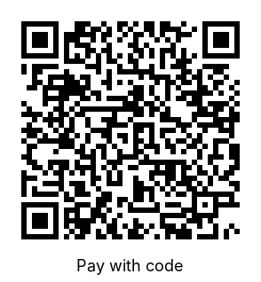

# EPC QR code (GiroCode) on invoices

YaBS prints an **EPC QR code** ("GiroCode", "Zahlen mit Code") on invoices. Your customer scans it with a banking app, and the SEPA transfer is filled in: recipient, IBAN, BIC, amount and reference. No typing, no typos.



The example contains:

```
BCD
002
1
SCT
COBADEFFXXX
Müller & Söhne GmbH
DE89370400440532013000
EUR1234.50


Invoice RE-00042
```

## What is in the code

| Field | Taken from |
|---|---|
| Recipient | Company info: business name (otherwise first name and name) |
| IBAN, BIC | The bank account assigned to the contact; otherwise the account of the company info |
| Amount | Gross amount of the invoice, in EUR |
| Reference | Type and number of the document, e.g. `Invoice RE-00042` |

The code follows the EPC standard (EPC069-12, version 002, UTF-8).

## When is a code printed?

- For **invoices**, **part payment invoices** and **deposit invoices**.
- Only if the company info has an **IBAN** (*Control Panel → Company Info*).
- For other documents (offers, orders, reminders, ...) or without an IBAN, the placeholder is removed from the document.

## Add the code to your own template

Works with ODT templates (LibreOffice / OpenOffice Writer):

1. Open your template in Writer and insert any picture (*Insert → Image*) where the code should be.
2. Right-click the picture → *Properties* → tab *Options* → **Name**: `QRCode.img`
3. Set the size you want (about 3 × 3.2 cm; the code is square with the caption "Pay with code" below).
4. Save the template and upload it again in *Control Panel → Template Manager*.

On export, YaBS replaces the picture with the QR code of the invoice. The template `DE-Yabs-2.0.odt` that comes with YaBS (new installations) already contains the code below the payment terms.

---

# EPC-QR-Code (GiroCode) auf Rechnungen (DE)

YaBS druckt auf Rechnungen einen **EPC-QR-Code** („GiroCode“, „Zahlen mit Code“). Ihr Kunde scannt ihn mit der Banking-App, die SEPA-Überweisung ist ausgefüllt: Empfänger, IBAN, BIC, Betrag und Verwendungszweck.

- **Inhalt**: Empfänger = Firmenname aus der Firmeninformation; IBAN/BIC = das dem Kontakt zugeordnete Konto, sonst das Konto der Firmeninformation; Betrag = Bruttobetrag der Rechnung; Verwendungszweck = Art und Nummer, z.B. `Rechnung RE-00042`.
- **Wann**: bei Rechnungen, Abschlags- und Anzahlungsrechnungen, wenn in der Firmeninformation eine **IBAN** eingetragen ist. Sonst wird der Platzhalter aus dem Dokument entfernt.
- **In eigene Vorlagen einfügen** (ODT): in Writer ein beliebiges Bild einfügen, Rechtsklick → *Eigenschaften* → Register *Optionen* → **Name**: `QRCode.img`, Größe ca. 3 × 3,2 cm. Vorlage speichern und unter *Systemsteuerung → Vorlagen-Manager* neu hochladen.
- Die mitgelieferte Vorlage `DE-Yabs-2.0.odt` (Neuinstallationen) enthält den Code bereits unter den Zahlungsbedingungen.
