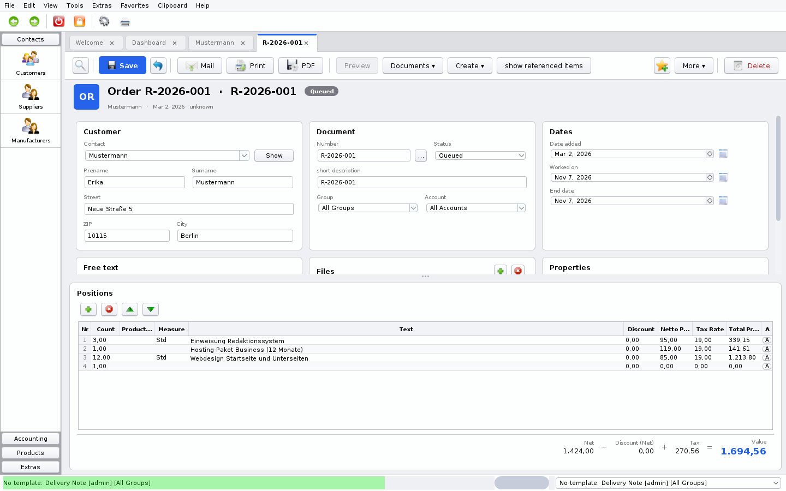
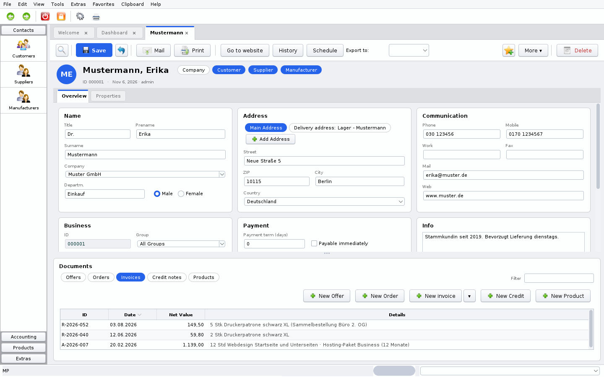
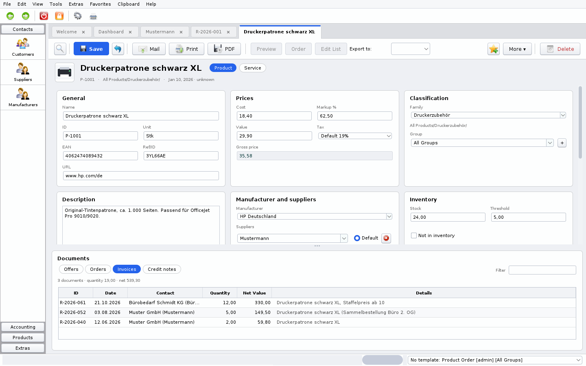
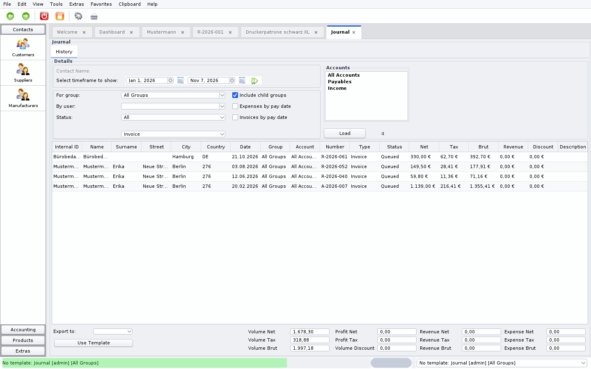

# YaBS – Yet another Business Software

**Angebote, Aufträge, Rechnungen, E-Rechnungen, Kunden, Artikel und Buchhaltung für Selbstständige und kleine Unternehmen – auf dem eigenen Rechner, mit den Daten in den eigenen Händen.**

Frei und Open Source (GPL v3) · Windows, Linux und macOS · Keine Cloud, kein Account, kein Abonnement

**[⬇ Neueste Version herunterladen](https://github.com/anti43/openyabs/releases)** · [Hinweise und Neuerungen](Hinweise.md) · [E-Rechnung (XRechnung / ZUGFeRD)](E-Rechnung.md)

> **Umstieg von Fakturama 2?** Ihre Daten kommen mit wenigen Klicks mit: *Datei › Import › Fakturama 2*, die `Database.script` von Fakturama auswählen, fertig. Kontakte, Artikel, Rechnungen und alle anderen Belege, Ausgaben und Steuersätze werden mit Belegnummern und Datum übernommen – Fakturama selbst bleibt unverändert. [Mehr](#import-export-und-umstieg-von-anderer-software)



---

## Inhaltsverzeichnis

- [Warum YaBS](#warum-yabs)
- [Ihre Daten bleiben bei Ihnen](#ihre-daten-bleiben-bei-ihnen)
- [Funktionen auf einen Blick](#funktionen-auf-einen-blick)
- [Kunden, Lieferanten und Hersteller](#kunden-lieferanten-und-hersteller)
- [Angebote, Aufträge, Rechnungen und mehr](#angebote-aufträge-rechnungen-und-mehr)
- [Centgenaue Beträge](#centgenaue-beträge)
- [E-Rechnung: XRechnung und ZUGFeRD](#e-rechnung-xrechnung-und-zugferd)
- [Druck, PDF, Vorlagen und E-Mail](#druck-pdf-vorlagen-und-e-mail)
- [Zahlungseingang: Fälligkeiten, Skonto, Mahnwesen](#zahlungseingang-fälligkeiten-skonto-mahnwesen)
- [Artikel, Dienstleistungen und Lager](#artikel-dienstleistungen-und-lager)
- [Buchhaltung: Journal, Einnahmen und Ausgaben](#buchhaltung-journal-einnahmen-und-ausgaben)
- [Terminplanung und wiederkehrende Rechnungen](#terminplanung-und-wiederkehrende-rechnungen)
- [Eine moderne, schnelle Benutzeroberfläche](#eine-moderne-schnelle-benutzeroberfläche)
- [Kasse für die Ladentheke (erster Entwurf)](#kasse-für-die-ladentheke-erster-entwurf)
- [Teams: Benutzer, Gruppen und Rechte](#teams-benutzer-gruppen-und-rechte)
- [Import, Export und Umstieg von anderer Software](#import-export-und-umstieg-von-anderer-software)
- [Für Power-User: Skripte, Plugins und SQL](#für-power-user-skripte-plugins-und-sql)
- [Installation](#installation)
- [Aktualisierung und bestehende Daten](#aktualisierung-und-bestehende-daten)
- [Aus dem Quellcode bauen](#aus-dem-quellcode-bauen)
- [Hilfe, Community und Lizenz](#hilfe-community-und-lizenz)

---

## Warum YaBS

- **Alles an einem Ort**: Kontakte, Angebote, Aufträge, Rechnungen, Abschlagszahlungen, Gutschriften, Mahnungen, Artikel, Lager, Ausgaben und ein Journal – nahtlos miteinander verknüpft.
- **Ihre Daten bleiben auf Ihrem Rechner**: Keine Cloud, keine Registrierung, kein Tracking, funktioniert 100 % offline. Siehe [unten](#ihre-daten-bleiben-bei-ihnen).
- **Vorbereitet auf die gesetzliche E-Rechnungspflicht**: XRechnung und ZUGFeRD nach EN 16931, vor dem Versand mit dem offiziellen Validator auf Gültigkeit geprüft.
- **Eigenes Design & Layout**: Rechnungen und Anschreiben aus eigenen LibreOffice / OpenOffice-Vorlagen (ODT) oder interaktiven PDF-Formularen.
- **Dauerhaft frei & kostenlos**: Open Source unter der GPL v3. Keine Lizenzkosten, keine Beschränkung der Arbeitsplätze, kein Lock-in.
- **Läuft überall**: Windows, Linux und macOS, einzeln oder im Team mit einer gemeinsamen Netzwerkdatenbank.

## Ihre Daten bleiben bei Ihnen

Das unterscheidet YaBS von webbasierten Cloud-Rechnungsdiensten:

- **Keine Cloud, kein Account.** YaBS ist eine echte Desktop-Anwendung. Niemand kann Ihr Konto sperren, Preise erhöhen oder Ihre betriebswirtschaftlichen Zahlen einsehen.
- **Alle Daten bleiben lokal.** Kunden, Rechnungen, Preise und Buchhaltung lagern in einer Datenbank auf Ihrem eigenen PC (eingebettete H2-Datenbank in `~/.yabs/h2`; ältere Installationen mit Apache Derby laufen weiter – siehe [Datenbank](Datenbank.md)) – oder auf Wunsch auf Ihrem eigenen Büroserver (MySQL / MariaDB).
- **Funktioniert komplett offline.** Angebote verfassen, Rechnungen schreiben und Buchhaltung benötigen keine Internetverbindung. YaBS geht nur dann online, wenn *Sie* eine entsprechende Aktion auslösen, wie das Senden einer E-Mail über Ihren eigenen SMTP-Server.
- **Keine Telemetrie, kein Tracking, keine Werbung.**
- **Normale Dateien auf Ihrer Festplatte.** PDFs, E-Rechnungen und Exporte landen in Verzeichnissen Ihrer Wahl. Die Datenbank ist ein normaler Ordner, den Sie einfach sichern oder auf einen USB-Stick kopieren können.
- **Einfach für die DSGVO.** Kundendaten werden keinem fremden Auftragsverarbeiter übergeben – sie verlassen zu keinem Zeitpunkt Ihren Computer.
- **Daten jederzeit exportierbar.** Kontakte und Dokumente lassen sich jederzeit nach CSV, XML, vCard oder HTML exportieren. Der Quellcode ist offen, das Dateiformat niemals ein Betriebsgeheimnis.
- **Software, die dauerhaft funktioniert.** Lokale Software verschwindet nicht plötzlich, wenn ein Startup aufgekauft oder ein Dienst eingestellt wird.

## Funktionen auf einen Blick

| Bereich | Was enthalten ist |
|---|---|
| **Kontakte** | Kunden, Lieferanten, Hersteller und Firmen; mehrere Anschriften; Bankverbindungen; Telefonnotizen, Dateianhänge und lückenlose Historie |
| **Dokumente** | Angebote, Aufträge, Rechnungen, Abschlagszahlungen, Teilrechnungen, Gutschriften, Lieferscheine, Auftragsbestätigungen, Mahnungen |
| **E-Rechnung** | XRechnung (XML), ZUGFeRD (PDF mit eingebettetem XML), validiert nach EN 16931, Ausgabeformat pro Kunde konfigurierbar |
| **Ausgabe** | Druck, PDF, ODT aus eigenen Vorlagen, E-Mail mit Anhängen, Serien-Mails, Sammeldruck, EPC-QR-Code (GiroCode) |
| **Artikel & Lager** | Artikel und Dienstleistungen, EK/VK-Preise, Margenkalkulation, Staffelpreise, Bildvorschau, EAN-Barcodes, Warengruppen und Stücklisten |
| **Lagerbestand** | Bestandsführung, Meldeschwellen, Bestellungen an Lieferanten, integrierter Bestandsmanager |
| **Finanzen** | Exakte Dezimalrechnung, separate MwSt.-Sätze, Rabatte, Skonto (Prozente & Tage), Fälligkeiten, Mahnspesen, Abschlagsverrechnung |
| **Buchhaltung** | Journal mit Einnahmen, Ausgaben, Gewinn und MwSt., Kontenrahmen, Barauslagen, SEPA-Lastschriftdatei (pain.008) |
| **Planung** | Kalender, Fälligkeitsradar, wiederkehrende Dauerrechnungen, Übersichts-Dashboard |
| **Arbeiten** | Moderne Kachelansicht, Tabs, Vor/Zurück wie im Browser, Favoriten, Volltextsuche, Tastenkürzel, Papierkorb, Rückgängig |
| **Teams** | Mehrere Benutzer, Mandanten/Gruppen, Datensatz-Sperren gegen gleichzeitiges Überschreiben, Rechteverwaltung |
| **Daten** | Lokale H2- oder Derby-Datenbank oder MySQL/MariaDB-Server, Zip-Sicherung, Verbindungs-Manager, CSV/XML/vCard/HTML-Import & Export, Ein-Klick-Import aus Fakturama 2, Migrationsassistenten |
| **Erweiterungen** | Groovy-Skripte und Konsole, Live-Plugin-Manager, SQL-Abfragefenster, Shopify-Bestellimport |

## Kunden, Lieferanten und Hersteller



- **Ein Kontakt, mehrere Rollen**: Ein Kontakt kann gleichzeitig Kunde, Lieferant, Hersteller und/oder Partnerfirma sein – dargestellt als Chips neben dem Namen und mit einem Klick umschaltbar.
- **Alles auf einer Seite**: Name, Anschriften (Haupt-, Rechnungs- und Lieferadresse), Telefon, Mail, Webseite, USt-IdNr., Bankverbindung, Zahlungsbedingungen und Notizen.
- **Alle Dokumente des Kontakts**: Angebote, Aufträge, Rechnungen, Gutschriften und Artikel direkt unter den Stammdaten – jeweils mit einzeiliger Positionsübersicht, Schnellfilter und Gesamtsumme.
- **Dokumente direkt aus dem Kontakt anlegen**: Neues Angebot, Auftrag, Rechnung, Gutschrift oder Artikel mit einem Klick erzeugen.
- **Individuelle Zahlungsbedingungen**: Zahlungsziel in Tagen oder „sofort fällig“, Skonto (% und Tage), das Ziel-Bankkonto und das E-Rechnungs-Format inklusive behördlicher Leitweg-ID.
- **Kommunikation**: Gesprächsnotizen, angehängte Dateien, E-Mail direkt versenden, Webseite im Browser öffnen.
- **Historie & Prüfung**: Jede Änderung wird protokolliert (wer hat was wann geändert). USt-IdNr. und IBAN werden bei der Eingabe live validiert.

## Angebote, Aufträge, Rechnungen und mehr

- **Der vollständige Verkaufsprozess**: Angebot → Auftrag → Anzahlung / Teilzahlung → Schlussrechnung → Gutschrift, jeweils mit einem Klick aus dem Vorgängerbeleg erstellt. Der Vorgänger wird als erledigt markiert und sauber referenziert.
- **Schlussrechnungen mit Abschlagsabzug**: Die Schlussrechnung übernimmt alle Positionen des Auftrags und zieht alle geleisteten Abschlags- und Teilzahlungen automatisch mit dem korrekten Steuersatz ab.
- **Flexible Positionen**: Menge, Einheit, Artikel, formatierter Freitext, Nettopreis, Steuersatz, Positionsrabatt, optionale Zusatzspalten oder reine Textzeilen; Zeilen verschieben, Artikel oder Belege einfügen.
- **Live-Summen**: Netto, Rabatt, Mehrwertsteuer und Gesamtbetrag aktualisieren sich sofort bei jeder Eingabe.
- **Statusverfolgung**: In Warteschlange, In Bearbeitung, Pausiert, Abgeschlossen, Bezahlt – mit automatischer Verbuchung des Zahldatums.
- **Eigene Nummernkreise**: Frei definierbare Belegnummern (z. B. `R-2026-001`) pro Belegart.
- **Lieferscheine & Auftragsbestätigungen**: Aus demselben Vorgang erstellbar, auf Wunsch zusammen ausgedruckt.
- **Sammelrechnungen**: Mehrere Rechnungen aus der Belegsuche zu einer Sammelrechnung zusammenfassen.
- **Soll-/Ist-Vergleich**: Rechnung direkt mit dem Auftrag vergleichen, um gelieferte und abgerechnete Mengen zu prüfen.

## Centgenaue Beträge

Eine kaufmännische Software darf nicht runden wie ein Taschenrechner. YaBS rechnet mit exakter Dezimalarithmetik (BigDecimal), niemals mit binärem Gleitkomma:

- Jede Zeile wird kaufmännisch auf den Cent gerundet, die Mehrwertsteuer wird **einmal pro Steuersatz** auf die Zwischensumme berechnet – exakt wie es der E-Rechnungsstandard EN 16931 vorschreibt. PDF und E-Rechnung weisen immer identische Beträge aus.
- Mehrere Steuersätze auf einer Rechnung (z. B. 19 % und 7 %) werden sauber aufgeschlüsselt.
- Zeilenrabatte, Staffelpreise, Skontobeträge und Mahngebühren werden einheitlich ermittelt – auf dem Bildschirm, im PDF, in der E-Rechnung und im Buchungsjournal.
- Zahlen werden im deutschen Format dargestellt (`1.234,56 €`).

## E-Rechnung: XRechnung und ZUGFeRD

- **XRechnung** (XML), **ZUGFeRD** (PDF/A-3 mit eingebettetem XML) oder beides nach **EN 16931**.
- **Amtlicher Prüfvalidator integriert**: Automatische Schematron-Validierung vor dem Speichern oder Versenden – fehlerhafte E-Rechnungen verlassen nicht das Haus, YaBS nennt den genauen Grund.
- **Pro Kunde einstellbar**: Ausgabeformat wählen (normales PDF, ZUGFeRD, XRechnung oder PDF + XRechnung), Leitweg-ID für Behörden, Zahlungsziele und Skonto.
- **Versand per E-Mail & Serien-E-Mail**: Jeder Empfänger erhält automatisch das für ihn hinterlegte Format.
- **Mehrere Bankverbindungen**: Je Kunde festlegen, welches Geschäftskonto auf der Rechnung ausgewiesen wird.
- Ausführliche Anleitung und rechtliche Hintergründe: **[docs/E-Rechnung.md](E-Rechnung.md)**.

## Druck, PDF, Vorlagen und E-Mail

- **Freies Layout**: Rechnungen, Angebote, Mahnungen und Briefe in LibreOffice / OpenOffice Writer (ODT) oder als PDF-Formular gestalten – mit Platzhaltern für Positionstabellen, MwSt.-Gruppen, Zahlungsbedingungen und **EPC-GiroCode (QR-Code)**.
- **Vorlagen nach Belegart, Benutzer und Mandant**: Unterschiedliche Briefköpfe für verschiedene Firmenzweige oder Abteilungen.
- **PDF- und ODT-Export** mit frei wählbaren Dateinamenmustern (z. B. nach Jahr und Kunde).
- **Direkter Mailversand**: Über Ihren eigenen SMTP-Server mit angehängter PDF- und/oder XML-Rechnung basierend auf Textvorlagen.
- **Serienbriefe & Sammeldruck**: Aus dem Journal heraus alle offenen Rechnungen eines Monats auf einmal drucken oder versenden.
- **Automatisches Archiv**: Jede gesendete E-Mail kann automatisch als Blindkopie (Bcc) an ein Archivpostfach gehen.

## Zahlungseingang: Fälligkeiten, Skonto, Mahnwesen

- **Fälligkeiten**: Automatisch aus den Kundeneinstellungen, der Vorlage oder den Firmenvorgaben.
- **Skonto**: Skontosatz in Prozent und Skontofrist in Tagen je Kunde mit automatischer Berechnung des Abzugsbetrags auf der Rechnung.
- **Überfällige Rechnungen im Blick**: Schnellübersicht auf dem Dashboard.
- **Mehrstufiges Mahnwesen**: Zahlungserinnerung, 1. Mahnung, 2. Mahnung mit eigenen Fristen, Texten und Mahngebühren.
- **SEPA-Lastschrift**: Im Journal unbezahlte Rechnungen auswählen, Rechtsklick › *SEPA-Lastschriftdatei erstellen* – die XML-Datei (pain.008, Basislastschrift) laden Sie im Online-Banking hoch. Dafür in der *Firmeninformation* IBAN und Gläubiger-ID eintragen; die IBAN der Kunden steht im Kontakt. Mandatsreferenz ist die Kundennummer, Mandatsdatum das Anlagedatum des Kontakts. Alle Voraussetzungen: [SEPA-Lastschrift](SEPA-Lastschrift.md).

## Artikel, Dienstleistungen und Lager



- **Artikel & Dienstleistungen**: Mit Artikelnummer, Einheit, EAN, Hersteller-Teilenummer, Beschreibung, Web-Link und **großem Artikelbild** im Kopfbereich für sofortige Erkennbarkeit.
- **Datenblatt-Verknüpfung**: Webadresse oder lokale Datei (z. B. auf dem Server `\\nas\docs\artikel.pdf`), mit einem Klick geöffnet.
- **Automatische Preiskalkulation**: EK und Aufschlag eingeben, Netto- oder Bruttopreis wählen – alle abhängigen Werte passen sich live an.
- **Staffelpreise**: Preisstaffeln nach Mindestmenge; der Beleg wählt automatisch den passenden Preis.
- **Stücklisten & Sets**: Vordefinierte Leistungspakete mit einem Klick in Angebote übernehmen.
- **Lieferantenvergleich**: Mehrere Lieferanten je Artikel mit direktem Shop-Link und aktuellem Einkaufspreis; der günstigste Lieferant wird hervorgehoben.
- **Verkaufshistorie**: Welcher Kunde hat den Artikel wann und zu welchem Preis bestellt?
- **Lagerverwaltung**: Mindestbestand, automatische Bestandsabbuchung bei Rechnungsstellung, Inventur und Lieferantenbestellungen.

## Buchhaltung: Journal, Einnahmen und Ausgaben



- **Journal**: Alle Belege, Einnahmen und Ausgaben eines Zeitraums mit Filtern nach Belegart, Status, Mandant, Bearbeiter und Sachkonto.
- **Einnahmen-Überschuss-Rechnung (EÜR)**: Einnahmen und Ausgaben werden erst mit tatsächlicher Zahlung gewertet (Zufluss-/Abflussprinzip).
- **Belege & Barausgaben**: Manuelle Erfassung von Ausgabenbelegen (z. B. Tankquittungen, Porto) mit Steuersatz und Kontierung.
- **Freie Kontenrahmen**: SKR03, SKR04 oder eigene Nummernkonten zuweisbar.
- **Dashboard**: Schnellansicht offener Angebote, unbezahlter Rechnungen und anstehender Termine.
- **Export für den Steuerberater**: Journal als PDF, CSV oder formatierte Auswertung exportieren.

## Terminplanung und wiederkehrende Rechnungen

- **Kalender**: Integrierte Terminübersicht verknüpft mit Belegen und Kundenkontakten.
- **Wiederkehrende Rechnungen (Abo-Rechnungen)**: Regelmäßige Rechnungsstellung (z. B. monatlich oder quartalsweise) automatisieren – mit einem Klick aus dem Dashboard erzeugt.
- **Fälligkeitswarnungen**: Automatische Hinweise auf überschrittene Zahlungsziele.

## Eine moderne, schnelle Benutzeroberfläche

- **Modernes Kacheldesign**: Übersichtliche Karten, runde Bedienelemente, aufgeräumte Tabs – die **klassische Ansicht bleibt mit einem Klick erreichbar** (*Ansicht › Layout › Modernes Aussehen*).
- **Responsives Layout**: Kacheln ordnen sich je nach Fensterbreite automatisch ein- bis dreispaltig an; optimiert für hochauflösende 4K- und HiDPI-Bildschirme.
- **Universalsuche (`Shift Shift` oder `Strg+F`)**: Wie in modernen IDEs findet ein einziges Suchfeld Kontakte, Rechnungen, Artikel, Termine, Menübefehle und Plugin-Funktionen.
- **Aktivitätsleiste unten rechts**: Alle Aktionen der Sitzung im Überblick – erstellte PDFs (sofort öffnen oder im Ordner anzeigen), geänderte Datensätze und Statusmeldungen.
- **Papierkorb & Historie**: Versehentlich gelöschte Einträge landen im Papierkorb und können jederzeit wiederhergestellt werden.
- **Vollständige Tastaturbedienung**: Schnelles Arbeiten ohne Maus über standardisierte Shortcuts (`Strg+S` Speichern, `Strg+P` Drucken, `Strg+Shift+P` PDF, `Strg+E` Mail).
- **Datumsfelder mit Schnelltippen**: Kurzeingaben wie `1.2.` (dieses Jahr), `010226`, `5` (5. des Monats), `+7` (in einer Woche) oder `h` / `heute`.
- **Als neu speichern (`Strg+Shift+S`)**: Öffnet eine ungespeicherte Kopie eines Belegs oder Artikels in einem neuen Tab zum schnellen Weiterbearbeiten.
- **Zoom wie im Browser**: Mit `Strg +`, `Strg −` und `Strg 0` die gesamte Oberfläche stufenlos von 80 % bis 200 % vergrößern.

## Kasse für die Ladentheke (erster Entwurf)

YaBS stellt auf Wunsch eine **Touch-Kasse als Weboberfläche** für Tablets, Touchscreens oder Smartphones im lokalen Netzwerk bereit:

- Aufruf über *Einstellungen › Kasse*. YaBS zeigt die **lokale Netzwerk-IP** (z. B. `http://192.168.1.20:8090/`) als Link und Kopiervorlage für das Touchgerät an.
- **Warengruppen auswählen**: Warengruppen für den Schnellverkauf an der Theke festlegen.
- **Verkauf per Fingertipp**: Kassierer loggen sich per PIN ein, tippen auf Artikelkacheln, wählen Barzahlung und erhalten das Wechselgeld centgenau berechnet.
- **Automatische Verbuchung**: Jeder Bon wird als bezahlte Rechnung für den „Barverkauf“ angelegt und fließt direkt in Umsatz und Journal ein.
- **Bon-Druck auf 80mm-Thermodrucker**: Vorlage *Kassenbon (Kasse)* für Bondrucker inklusive Ausdruck oder PDF-Anzeige.
- **Rechtlicher Hinweis (Deutschland):** Kassen im gewerblichen Barverkauf unterliegen der KassenSichV (§ 146a AO) und benötigen eine zertifizierte technische Sicherheitseinrichtung (TSE). Dieser erste Entwurf enthält **noch keine TSE** und dient zu Testzwecken oder für Bereiche ohne TSE-Pflicht.

## Teams: Benutzer, Gruppen und Rechte

- **Mehrbenutzerbetrieb**: Jeder Benutzer hat eigene Einstellungen, Vorlagen und Vorgabewerte.
- **Gruppen & Mandanten**: Getrennte Firmen, Filialen oder Abteilungen mit eigenen Nummernkreisen und Dokumentvorlagen.
- **Detaillierte Rechte**: Getrennt nach Ansehen, Exportieren, Bearbeiten, Anlegen/Löschen und Administrieren.
- **Datensatz-Sperre**: Wenn ein Mitarbeiter einen Beleg bearbeitet, können andere ihn nicht versehentlich überschreiben.
- **Gemeinsame Datenbank**: Mehrere Arbeitsplätze greifen im lokalen Netzwerk gemeinsam auf einen MariaDB- oder MySQL-Server zu – ganz ohne fremde Cloud.

## Import, Export und Umstieg von anderer Software

- **Import**: Kontakte und Artikel aus CSV, vCard und XML importieren.
- **Export**: Stammdaten, Belege und Auswertungen nach CSV, XML, vCard, HTML und PDF exportieren.
- **Einfacher Umstieg von Fakturama 2**: Unter *Datei › Import › Fakturama 2* die `Database.script`-Datei Ihres Fakturama-Arbeitsbereichs auswählen (Ordner `Database`, Fakturama vorher schließen). Übernommen werden Steuersätze, Warengruppen, Kontakte (Kunden, Lieferanten, Hersteller) mit Anschrift und Bankverbindung, Artikel mit Bildern, Lagerbestand und Staffelpreisen, Rechnungen, Angebote, Aufträge, Lieferscheine und Gutschriften mit Positionen und Versandkosten sowie Ausgabenbelege – jeweils mit Belegnummern und Datum. Fakturamas Dateien werden nicht verändert; bereits übernommene Datensätze werden übersprungen, der Import kann also wiederholt werden. Er zählt die Datensätze vorab und zeigt den Fortschritt mit der Restzeit an.
- **Umstieg von YaBS 1.3.2 (Derby → H2)**: Unter *Datei › Import › Von YaBS 1.3.2 …* den Ordner der alten Datenbank wählen (meist `~/.yabs/<Datenbankname>`, YaBS findet ihn in der Regel selbst; YaBS 1.3.2 vorher schließen). Vorher eine neue, leere Datenbank anlegen (*Datei › Verbindungen › Neue Datenbank …*). Übernommen wird alles – Kontakte, Belege mit Positionen, Artikel, Ausgaben, Einnahmen, Konten, Steuersätze, Benutzer mit Passwörtern und Rechten, Einstellungen, Nummernformate, Vorlagen und Dateien, Verlauf, Termine und mehr – mit Nummern, Datum und den alten IDs. Die alte Datenbank wird nicht verändert (eine Kopie wird gelesen); am Ende zeigt ein Bericht je Tabelle, was übernommen wurde. Details in den [Hinweisen](Hinweise.md).
- **Shopify**: Neue Bestellungen Ihres Shopify-Shops als Aufträge oder Rechnungen übernehmen, Kunden als Kontakte – siehe [Shopify](Shopify.md).

## Für Power-User: Skripte, Plugins und SQL

- **Groovy-Plugins**: Einfache `.groovy`-Dateien (ohne Build-Schritt) in den `plugins`-Ordner legen. Neue Menüpunkte, Felder, Validierungen und Reaktionen auf Belege hinzufügen.
- **Integrierter Editor**: Groovy-Editor mit Syntax-Highlighting, Zeilennummern, Vorlagen und Sofort-Kompilierung bei `Strg+S`. [Plugin-Anleitung](Plugins.md).
- **Groovy-4-Konsole**: Automatisierte Datenbereinigung oder Sonderberechnungen.
- **SQL-Abfragefenster**: Direkte SELECT- und Auswertungsabfragen auf die lokale oder zentrale Datenbank.

## Installation

YaBS läuft auf **Windows, Linux und macOS**.

**Installationspakete** (enthalten eine vorkonfigurierte Java-Laufzeitumgebung – keine manuelle Java-Installation nötig):

| System | Paket | Installation |
|---|---|---|
| **Windows** | `.msi` | Per Doppelklick installieren |
| **Debian, Ubuntu, Linux Mint** | `.deb` | `sudo apt install ./yabs_*.deb` |
| **Fedora, openSUSE, RHEL** | `.rpm` | `sudo dnf install ./yabs-*.rpm` |
| **macOS (Apple Silicon `arm64`, Intel `x86_64`)** | `.dmg` | Öffnen und in *Programme* ziehen (beim ersten Start Rechtsklick › *Öffnen*) |

**Plattformunabhängiges ZIP** (benötigt **Java 21** oder neuer, z. B. von [adoptium.net](https://adoptium.net)): Entpacken und `yabs.bat` (Windows) oder `yabs.sh` (Linux/macOS) ausführen – oder `java -jar openyabs.jar`.

Alle Downloads: **[Releases auf GitHub](https://github.com/anti43/openyabs/releases)**

Beim ersten Programmstart fragt ein Assistent nach dem Speicherort: **Auf diesem Computer** (ein Klick, Standard) oder auf einem **Datenbankserver** (MySQL / MariaDB). Die Einrichtung erfolgt automatisch, deutsche Systeme starten auf Deutsch und Sie sind als `admin` (Passwort `password` – bitte unter *Einstellungen › Benutzer* ändern) angemeldet.

## Aktualisierung und bestehende Daten

- Bestehende Datenbanken werden beim ersten Start nach einem Update automatisch auf das neue Schema aktualisiert.
- Die deutsche Sprachdatei wird nach Updates automatisch auf den neuesten Stand gebracht.
- Vor jedem Update empfiehlt sich eine Sicherheitskopie des Datenbankordners.
- Weitere Hinweise: [docs/Hinweise.md](Hinweise.md).

## Aus dem Quellcode bauen

```bash
./gradlew test distributionZip
```

Das ZIP-Paket wird im Ordner `build/distributions/` erstellt. Voraussetzung ist Java 21. Nach `./gradlew build` kopiert Gradle alle Abhängigkeiten nach `build/libs/lib/`, sodass `java -jar build/libs/openyabs.jar` direkt startet.

## Hilfe, Community und Lizenz

- Plugins erstellen: [docs/Plugins.md](Plugins.md)
- Fragen und Support (Deutsch & Englisch): Mailingliste [openyabs@googlegroups.com](mailto:openyabs@googlegroups.com) · [Archiv](https://groups.google.com/forum/#!forum/openyabs)
- Dokumentation: [Handbuch](https://docs.google.com/document/d/1VhUi0wS-EJgfV-o89Hl-2wux810mJnqUV1wPxpgVIs4/pub) · [Hinweise und Neuerungen](Hinweise.md) · [E-Rechnung](E-Rechnung.md)
- Ursprüngliches Projekt: [anti43/openyabs](https://github.com/anti43/openyabs) · [Heise Download](http://www.heise.de/download/yabs-yet-another-business-software-1149250.html) · [Ubuntuusers Wiki](http://wiki.ubuntuusers.de/Yabs)

YaBS ist freie Software unter der **GNU General Public License v3**. Verwendete Bibliotheken und Lizenzen: [licenses-list.txt](https://github.com/anti43/openyabs/blob/master/licenses-list.txt).
